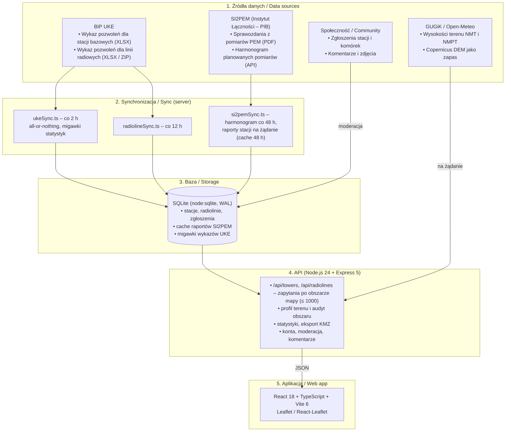

# BTMap v2 📡🇵🇱

[](https://github.com/JUreK646/btmapv2)
[](https://nodejs.org)
[](https://react.dev)
[](https://www.typescriptlang.org/)
[](LICENSE)
[](https://github.com/JUreK646/btmapv2/actions/workflows/ci.yml)
[](https://github.com/JUreK646/btmapv2/actions/workflows/codeql.yml)
[](.github/SECURITY.md)

> **[PL]** Otwarta, społecznościowa mapa stacji bazowych telefonii komórkowej (GSM / UMTS / LTE / 5G), linii radiowych (radiolinii) oraz pomiarów pól elektromagnetycznych (PEM) w Polsce, zbudowana na publicznych rejestrach UKE i SI2PEM.
> **[EN]** An open, community-driven map of cellular base stations (GSM / UMTS / LTE / 5G), microwave radio links and electromagnetic field (EMF/PEM) measurements in Poland, built on the public UKE and SI2PEM registries.

---

## 🏛️ Architektura / Architecture



---

## 🌐 Nawigacja / Navigation
- [🇵🇱 Opis projektu (polski)](#-opis-projektu-polski)
  - [Funkcje](#-funkcje)
  - [Skąd pochodzą dane](#-skąd-pochodzą-dane)
  - [Ograniczenia danych](#️-ograniczenia-danych)
  - [Uruchomienie](#-uruchomienie)
- [🇬🇧 Project overview (English)](#-project-overview-english)
  - [Features](#-features)
  - [Where the data comes from](#-where-the-data-comes-from)
  - [Data limitations](#️-data-limitations)
  - [Getting started](#-getting-started)
- [🛠️ Tech stack](#️-tech-stack)
- [🤝 Contributing & Security](#-contributing--security)
- [📚 Citation](#-citation)
- [📄 License](#-license)

---

# 🇵🇱 Opis projektu (polski)

**BTMap v2** to aplikacja internetowa dla pasjonatów telekomunikacji, instalatorów, badaczy i mieszkańców, którzy chcą sprawdzić, jakie stacje bazowe i linie radiowe działają w ich okolicy. Łączy oficjalne rejestry UKE i SI2PEM z danymi zgłaszanymi przez społeczność.

### 📶 Operatorzy i pasma
* 🟠 **Orange Polska**, 🟣 **Play (P4)**, 🟢 **Plus (Polkomtel)**, 🔴 **T-Mobile Polska**
* Pozostałe podmioty z wykazu UKE, m.in. PKP PLK (GSM-R), PGE Systemy, TOPR i sieci prywatne.
* Technologie i pasma pochodzą z wykazu UKE: GSM, UMTS, LTE, 5G NR (w tym 700, 2100, 2600 i 3600 MHz), a także CDMA i IoT.

---

### 🚀 Funkcje

1. **Mapa stacji bazowych**
   * Stacje z wykazu UKE i z bazy społecznościowej BTMap, filtrowane po operatorze, technologii, paśmie, trybie 5G, województwie i źródle danych.
   * W widoku mapy serwer zwraca do 1000 stacji z bieżącego obszaru. Mapa nie grupuje stacji w klastry, więc przy małym przybliżeniu widać tylko część z nich — więcej pojawia się po przybliżeniu.
   * Oznaczenie „nowe” dla stacji i pozwoleń z ostatnich 30 dni przed datą ostatniego wykazu UKE.
   * Podkłady: OpenStreetMap, zdjęcia satelitarne i mapa topograficzna Esri oraz opcjonalnie Google Satellite (wymaga własnego klucza API).

2. **Azymuty anten**
   * Kierunki sektorów rysowane na mapie i w karcie stacji, z podanym źródłem: raport SI2PEM, pozwolenie UKE, weryfikacja w terenie albo zgłoszenie społeczności.
   * Stacja bez danych o azymutach nie ma ich na mapie — kierunki nie są szacowane.

3. **Linie radiowe (radiolinie)**
   * Przęsła z wykazu pozwoleń UKE z kanałami, częstotliwościami, polaryzacją, modulacją, przepustowością i mocą EIRP — w takim zakresie, w jakim podaje je rejestr.
   * Brakujące wartości są wyświetlane jako „brak danych”.

4. **Pomiary PEM (SI2PEM)**
   * Lista sprawozdań z pomiarów dla wybranej stacji z odnośnikami do dokumentów źródłowych.
   * Odczyt tabel antenowych z plików PDF ([`server/pemPdf.ts`](server/pemPdf.ts), na bazie `pdfjs-dist`): modele anten, wysokości, azymuty, pochylenia, moc EIRP i pasma.
   * Warstwa planowanych pomiarów z terminami i laboratoriami.

5. **Narzędzia analityczne**
   * **Profil terenu** między stacją a wskazanym punktem: wysokości z GUGiK (NMT LiDAR 1 m, z pokryciem terenu NMPT) albo Copernicus DEM, widoczność optyczna, strefa Fresnela i tłumienie. Bez danych wysokościowych profil nie jest liczony.
   * **Audyt obszaru** porównujący czterech głównych operatorów w danym miejscu (wynik 0–100). To orientacyjny wskaźnik oparty na odległości, pasmach, azymutach i widoczności, a nie pomiar zasięgu. Uwzględnia tylko stacje z pomiarami w SI2PEM, a brakujące dane ocenia neutralnie i wypisuje.

6. **Statystyki**
   * Struktura wykazu UKE i bazy BTMap według operatorów, technologii, pasm i województw, statystyki radiolinii oraz jakość danych.
   * Przyrosty to różnica między kolejnymi wykazami UKE. Migawka liczb zapisuje się przy każdej synchronizacji, więc przyrosty pojawiają się od drugiego zsynchronizowanego wykazu.

7. **Społeczność**
   * Zgłaszanie nowych stacji z komórkami (eNB/gNB ID, CID, PCI, EARFCN, azymuty) z walidacją według polskiego planu pasm. Zgłoszenia trafiają do moderacji.
   * Komentarze i zdjęcia przy stacjach z bazy BTMap, historia zmian stacji.
   * Wyszukiwanie po adresie, miejscowości, ID stacji, eNB/gNB ID i identyfikatorach komórek (m.in. format NetMonster).

8. **Eksport i inne**
   * Eksport stacji i radiolinii do KMZ (Google Earth) dla całej Polski lub województwa.
   * Interfejs po polsku i angielsku, motyw jasny i ciemny, changelog pod `/btmap/changelog`.

---

### 🔎 Skąd pochodzą dane

| Dane | Źródło | Odświeżanie |
|---|---|---|
| Stacje bazowe i pozwolenia | [BIP UKE – wykaz pozwoleń](https://bip.uke.gov.pl/pozwolenia-radiowe/wykaz-pozwolen-radiowych-tresci/stacje-gsm-umts-lte-5gnr-oraz-cdma,12,0.html) (XLSX) | sprawdzane co 2 h, import tylko przy zmianie plików |
| Azymuty z pozwoleń | plik KML z pozwoleniami UKE (`pnpm import:azimuths`) | ręcznie |
| Linie radiowe | BIP UKE, zapasowo dane.gov.pl | sprawdzane co 12 h |
| Planowane pomiary PEM | API SI2PEM | co 48 h |
| Sprawozdania PEM stacji | SI2PEM | przy otwarciu stacji, cache 48 h |
| Wysokości terenu | GUGiK NMT/NMPT, zapasowo Open-Meteo (Copernicus DEM) | przy każdym profilu |

Synchronizacja wykazu UKE działa na zasadzie „wszystko albo nic”: jeśli którykolwiek plik technologii nie pobierze się lub nie da się go odczytać, baza zostaje bez zmian. Więcej w [docs/DATA_SOURCES.md](docs/DATA_SOURCES.md).

---

### ⚠️ Ograniczenia danych

* **Wykaz UKE to pozwolenia, a nie stan sieci.** Pozwolenie nie oznacza, że nadajnik jest już uruchomiony. Stacja, której nie ma w nowym wykazie, jest usuwana z mapy przy synchronizacji.
* **Tryb 5G (SA/NSA)** nie wynika z wykazu UKE. Filtr trybu 5G obejmuje więc tylko stacje z bazy BTMap, przy których tryb wpisano w zgłoszeniu.
* **Azymuty** są dostępne tylko dla części stacji (patrz wyżej).
* **Audyt obszaru i profil terenu** to modele obliczeniowe, a nie pomiary zasięgu.

---

### 💻 Uruchomienie

**Wymagania:** Node.js `>= 24.0.0` i `pnpm`.

```bash
git clone https://github.com/JUreK646/btmapv2.git
cd btmapv2
pnpm install
pnpm dev
```

Aplikacja otworzy się pod adresem `http://127.0.0.1:5174/btmap`, a API działa na porcie 3001. Przy pierwszym uruchomieniu baza `data/btmap.sqlite` jest pusta — dane pobierzesz poleceniami `sync:*` poniżej.

#### Skrypty

| Polecenie | Działanie |
|---|---|
| `pnpm dev` | serwer API i frontend Vite jednocześnie |
| `pnpm build` | sprawdzenie typów i produkcyjny build frontendu |
| `pnpm typecheck` | sprawdzenie typów frontendu i serwera |
| `pnpm test` | testy (`node --test`) |
| `pnpm server` | sam serwer API |
| `pnpm sync:uke [--force]` | pobranie wykazu stacji UKE (`--force` pobiera nawet bez zmian) |
| `pnpm sync:radiolines [plik.zip\|plik.xlsx]` | pobranie wykazu linii radiowych albo import z pliku |
| `pnpm sync:si2pem [--force]` | pobranie harmonogramu pomiarów SI2PEM |
| `pnpm import:kml [plik] [baza]` | import stacji z pliku KML/KMZ (Python) |
| `pnpm import:azimuths [plik] [baza]` | dopisanie azymutów z pliku KML UKE do istniejących stacji |

Konto administratora (moderacja zgłoszeń) zakłada się z wiersza poleceń — hasło (min. 12 znaków) podaje się w zmiennej `BTMAP_ADMIN_PASSWORD`:

```bash
node --experimental-strip-types scripts/create-admin.mjs admin@example.com
```

#### Docker

```bash
docker compose up -d --build
```

Frontend (nginx) działa pod `http://127.0.0.1:8080`, a API w osobnym kontenerze z bazą w `./data`. Zmienne środowiskowe są opisane w [`.env.example`](.env.example). Najważniejsze:
* `PUBLIC_HOST` — publiczna nazwa hosta (bez `https://`), z której przyjmowane są żądania zapisu.
* `TRUST_PROXY` — liczba serwerów proxy przed API. `docker-compose.yml` ustawia `1` dla wbudowanego nginx. Jeśli przed nim stoi jeszcze np. Cloudflare, ustaw `2`, inaczej limit prób logowania będzie wspólny dla wszystkich.
* `VITE_GOOGLE_MAPS_API_KEY` — opcjonalny klucz do podkładu Google Satellite.

---

### 🔬 Otwarte dane i Claude for Open Source

* **Przejrzystość danych publicznych.** Informacje o infrastrukturze telekomunikacyjnej i pomiarach PEM są rozproszone w arkuszach UKE i plikach PDF w SI2PEM. BTMap zbiera je w jednym miejscu i udostępnia bezpłatnie, w oparciu o ustawę o otwartych danych (*Dz.U. 2021 poz. 1641*) i dyrektywę *(UE) 2019/1024*.
* **Odczyt sprawozdań PDF.** Sprawozdania z pomiarów PEM mają różne układy tabel, zależnie od laboratorium. Parser w [`server/pemPdf.ts`](server/pemPdf.ts) odtwarza tabele z położenia tekstu i linii w PDF i wyciąga z nich dane anten. Nie każdy układ da się odczytać — wtedy aplikacja odsyła do dokumentu źródłowego.
* **Zasada „bez zgadywania”.** Brakujące dane (azymuty, wysokości, przepustowość radiolinii, przyrosty) są pokazywane jako brak, a nie uzupełniane wartościami typowymi.
* **Jakość kodu.** Kod jest na licencji MIT, TypeScript działa w trybie `strict`, a GitHub Actions uruchamia testy, sprawdzenie typów, build i CodeQL przy każdym pushu. Aplikacja nie zawiera narzędzi analitycznych ani śledzących.

---

# 🇬🇧 Project overview (English)

**BTMap v2** is a web app for telecom enthusiasts, installers, researchers and residents who want to see which base stations and radio links operate around them. It combines the official UKE and SI2PEM registries with community-submitted data.

### 📶 Networks and bands
* 🟠 **Orange Polska**, 🟣 **Play (P4)**, 🟢 **Plus (Polkomtel)**, 🔴 **T-Mobile Polska**
* Other licensees from the UKE registry, including PKP PLK (GSM-R), PGE Systemy, TOPR and private networks.
* Technologies and bands come from the UKE registry: GSM, UMTS, LTE, 5G NR (including 700, 2100, 2600 and 3600 MHz), plus CDMA and IoT.

---

### 🚀 Features

1. **Base station map** — UKE registry and community stations, filtered by operator, technology, band, 5G mode, province and data source. The map view returns up to 1,000 stations for the current area. There is no clustering, so a zoomed-out map shows only part of them. A "new" marker covers stations and permits from the 30 days before the latest UKE registry. Basemaps: OpenStreetMap, Esri satellite and topographic, and optionally Google Satellite (your own API key).
2. **Antenna azimuths** — sector directions on the map and in the station card, labelled with their source: SI2PEM report, UKE permit, on-site verification or a community submission. Stations without azimuth data show none; directions are never estimated.
3. **Microwave links** — hops from the UKE permit registry with channels, frequencies, polarisation, modulation, capacity and EIRP, as far as the registry states them. Missing values are shown as "no data".
4. **EMF measurements (SI2PEM)** — measurement reports per station with links to the source documents, antenna tables read from the PDFs ([`server/pemPdf.ts`](server/pemPdf.ts), built on `pdfjs-dist`), and a layer of scheduled measurements.
5. **Analysis tools** — a **terrain profile** between a station and a point (GUGiK NMT LiDAR 1 m with NMPT surface data, or Copernicus DEM; line of sight, Fresnel zone, path loss; no profile without elevation data) and an **area audit** comparing the four main operators on a 0–100 scale. The audit is an indicator based on distance, bands, azimuths and line of sight — not a coverage measurement. It only counts stations with SI2PEM measurements and rates missing inputs neutrally, listing them.
6. **Statistics** — the UKE registry and BTMap database by operator, technology, band and province, radio link statistics and data quality. Growth is the difference between consecutive UKE registries; a snapshot is saved on every sync, so growth appears from the second synced registry on.
7. **Community** — station and cell submissions (eNB/gNB ID, CID, PCI, EARFCN, azimuths) validated against the Polish band plan and moderated, comments and photos on BTMap stations, station history, and search by address, town, station ID, eNB/gNB ID and cell identifiers (including NetMonster notation).
8. **Export and more** — KMZ export (Google Earth) of stations and radio links for all of Poland or one province, Polish and English UI, light and dark theme, changelog at `/btmap/changelog`.

---

### 🔎 Where the data comes from

| Data | Source | Refresh |
|---|---|---|
| Base stations and permits | [BIP UKE permit registry](https://bip.uke.gov.pl/pozwolenia-radiowe/wykaz-pozwolen-radiowych-tresci/stacje-gsm-umts-lte-5gnr-oraz-cdma,12,0.html) (XLSX) | checked every 2 h, imported only when the files change |
| Azimuths from permits | UKE permit KML file (`pnpm import:azimuths`) | manual |
| Microwave links | BIP UKE, dane.gov.pl as fallback | checked every 12 h |
| Scheduled EMF measurements | SI2PEM API | every 48 h |
| EMF reports per station | SI2PEM | when a station is opened, cached 48 h |
| Terrain elevation | GUGiK NMT/NMPT, Open-Meteo (Copernicus DEM) as fallback | per profile |

The UKE registry sync is all-or-nothing: if any technology file fails to download or parse, the database is left unchanged. See [docs/DATA_SOURCES.md](docs/DATA_SOURCES.md).

---

### ⚠️ Data limitations

* **The UKE registry lists permits, not the live network.** A permit does not mean the transmitter is on air. A station missing from a new registry is removed from the map on sync.
* **5G mode (SA/NSA)** is not part of the UKE registry, so the 5G mode filter only covers BTMap stations whose submitted cells have a mode.
* **Azimuths** exist only for part of the stations (see above).
* **The area audit and terrain profile** are calculations, not coverage measurements.

---

### 🚀 Getting started

**Requirements:** Node.js `>= 24.0.0` and `pnpm`.

```bash
git clone https://github.com/JUreK646/btmapv2.git
cd btmapv2
pnpm install
pnpm dev
```

Open `http://127.0.0.1:5174/btmap`; the API listens on port 3001. On first start `data/btmap.sqlite` is empty — fetch data with the `sync:*` commands below.

| Command | What it does |
|---|---|
| `pnpm dev` | API server and Vite frontend together |
| `pnpm build` | type check and production frontend build |
| `pnpm typecheck` | type check of frontend and server |
| `pnpm test` | tests (`node --test`) |
| `pnpm server` | API server only |
| `pnpm sync:uke [--force]` | download the UKE station registry (`--force` even if unchanged) |
| `pnpm sync:radiolines [file.zip\|file.xlsx]` | download the radio link registry or import a local file |
| `pnpm sync:si2pem [--force]` | download the SI2PEM measurement schedule |
| `pnpm import:kml [file] [db]` | import stations from a KML/KMZ file (Python) |
| `pnpm import:azimuths [file] [db]` | add azimuths from the UKE KML file to existing stations |

Create an administrator account (for moderation) from the command line, with a password of at least 12 characters in `BTMAP_ADMIN_PASSWORD`:

```bash
node --experimental-strip-types scripts/create-admin.mjs admin@example.com
```

**Docker:** `docker compose up -d --build` serves the frontend (nginx) at `http://127.0.0.1:8080`, with the API in its own container and the database in `./data`. Environment variables are documented in [`.env.example`](.env.example) — most importantly `PUBLIC_HOST`, `TRUST_PROXY` (number of proxies in front of the API; `docker-compose.yml` sets `1` for the bundled nginx) and the optional `VITE_GOOGLE_MAPS_API_KEY`.

---

### 🔬 Open data & Claude for Open Source

* **Public data transparency.** Information about telecom infrastructure and EMF measurements is scattered across UKE spreadsheets and SI2PEM PDF files. BTMap brings it together and makes it freely available, under the Polish Open Data Act (*Dz.U. 2021 poz. 1641*) and the EU Open Data Directive *(EU) 2019/1024*.
* **Reading PDF reports.** EMF measurement reports use different table layouts depending on the laboratory. The parser in [`server/pemPdf.ts`](server/pemPdf.ts) rebuilds tables from text and line positions in the PDF and extracts antenna data. Not every layout can be read; in that case the app links to the source document.
* **No guessing.** Missing data (azimuths, heights, link capacity, growth figures) is shown as missing, never filled in with typical values.
* **Code quality.** MIT-licensed, TypeScript in `strict` mode, and GitHub Actions run tests, type checks, the build and CodeQL on every push. The app contains no analytics or tracking.

---

## 🛠️ Tech Stack

* **Frontend:** React 18, TypeScript 5.9, Vite 6, Leaflet 1.9 + React-Leaflet 4, Lucide icons, Manrope font
* **Backend:** Node.js 24 (`--experimental-strip-types`), Express 5, SQLite through `node:sqlite`
* **Data processing:** `read-excel-file` (UKE registries), a built-in ZIP/XLSX reader for radio link registries, `pdfjs-dist` (SI2PEM reports), `sharp` (photos)
* **Deployment:** Docker (nginx for the frontend, Node.js for the API), GitHub Actions (CI, CodeQL, OpenSSF Scorecard)

---

## 🤝 Contributing & Security

Poprawki, zgłoszenia błędów i korekty danych stacji są mile widziane. Contributions, bug reports and data corrections are welcome.
* Zasady współpracy / Contribution guidelines: [CONTRIBUTING.md](.github/CONTRIBUTING.md)
* Bezpieczeństwo / Security policy: [SECURITY.md](.github/SECURITY.md)
* Źródła danych / Data sources: [docs/DATA_SOURCES.md](docs/DATA_SOURCES.md)

---

## 📚 Citation

If you use BTMap or its data pipelines in research, please cite it using [`CITATION.cff`](CITATION.cff):

```bibtex
@software{Janiszewski_BTMap_2026,
  author = {Janiszewski, Jerzy},
  title = {{BTMap: Open-source Cellular Telecommunications and RF Infrastructure Platform}},
  version = {2.0.3},
  year = {2026},
  url = {https://github.com/JUreK646/btmapv2}
}
```

---

## 📄 License
This project is open source under the [MIT License](LICENSE).
