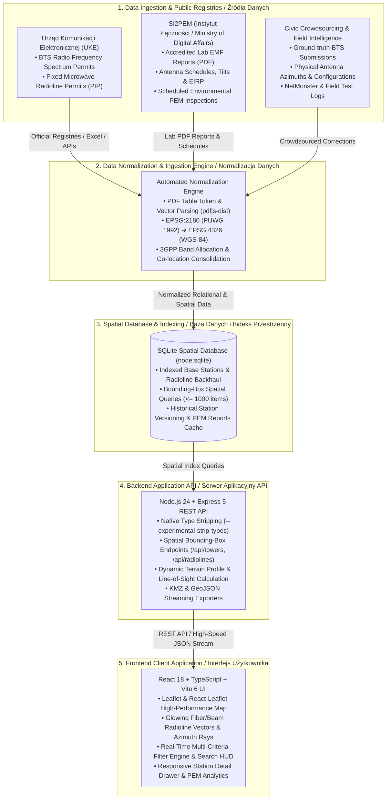

# BTMap v2 📡🇵🇱

[](https://github.com/JUreK646/btmapv2)
[](https://nodejs.org)
[](https://react.dev)
[](https://www.typescriptlang.org/)
[](LICENSE)
[](https://github.com/JUreK646/btmapv2/actions/workflows/ci.yml)
[](https://github.com/JUreK646/btmapv2/actions/workflows/codeql.yml)
[](.github/SECURITY.md)

> **[PL]** Otwarty, społecznościowy projekt interaktywnej mapy oraz zaawansowanej platformy analizy stacji bazowych telefonii komórkowej (BTS / GSM / UMTS / LTE / 5G), linii radiowych (PtP) oraz pomiarów pól elektromagnetycznych (PEM) w Polsce.  
> **[EN]** An open-source, civic-tech platform and interactive map of cellular infrastructure (BTS / GSM / UMTS / LTE / 5G), point-to-point microwave backhaul links, and environmental electromagnetic field (EMF/PEM) measurements in Poland.

---

## 🏛️ System Architecture / Architektura Systemu



---

## 🌐 Nawigacja / Navigation
- [🇵🇱 Opis Projektu (Polski)](#-opis-projektu-polski)
  - [Kluczowe Osiągnięcia i Innowacje (Milestones)](#-kluczowe-osiągnięcia-i-innowacje-milestones)
  - [Otwarta Nauka, Dane Obywatelskie i Claude for Open Source](#-otwarta-nauka-dane-obywatelskie-i-claude-for-open-source)
  - [Obsługiwane Sieci i Operatorzy](#-obsługiwane-sieci-i-operatorzy)
  - [Technologie i Pasma Radiowe](#-technologie-i-pasma-radiowe)
  - [Główne Funkcjonalności](#-główne-funkcjonalności)
  - [Wymagania i Uruchomienie](#-wymagania-i-uruchomienie)
- [🇬🇧 Project Overview (English)](#-project-overview-english)
  - [Key Milestones & Recent Innovations](#-key-milestones--recent-innovations)
  - [Open Science, Civic Data & Claude for Open Source](#-open-science-civic-data--claude-for-open-source)
  - [Supported Networks & Carriers](#-supported-networks--carriers)
  - [Technologies & Frequency Bands](#-technologies--frequency-bands)
  - [Key Features](#-key-features)
  - [Getting Started & Development](#-getting-started)
- [🛠️ Tech Stack](#️-tech-stack)
- [🤝 Contributing & Security](#-contributing--security)
- [📚 Citation](#-citation)
- [📄 License](#-license)

---

# 🇵🇱 Opis Projektu (Polski)

**BTMap v2** to nowoczesna, otwarta platforma internetowa i narzędzie inżynierii radiowej stworzone z myślą o pasjonatach telekomunikacji, inżynierach RF, instalatorach antenowych, badaczach oraz obywatelach analizujących infrastrukturę sieci bezprzewodowych w Polsce.

Projekt łączy oficjalne publiczne rejestry telekomunikacyjne i środowiskowe ze społecznościową weryfikacją danych terenowych, zapewniając bezprecedensowy wgląd w architekturę stacji bazowych (BTS), linie radiowe (PtP) oraz rozkłady pól elektromagnetycznych (PEM).

---

### 🏆 Kluczowe Osiągnięcia i Innowacje (Milestones)

W najnowszej odsłonie BTMap v2 zrealizowano przełomowe usprawnienia technologiczne:

1. **Ogólnopolskie śledzenie 5G Standalone (SA) oraz C-Band 3500 MHz (n78):**
   * Precyzyjne wykrywanie i mapowanie stacji 5G Ultra w docelowym paśmie pojemnościowym C-Band (3400–3800 MHz, pasmo n78) dla wszystkich operatorów infrastrukturalnych w Polsce (Orange, Play, Plus, T-Mobile).
   * Rozróżnianie architektury 5G Standalone (SA z dedykowanym rdzeniem 5GC) od współdzielonego pasma DSS (Dynamic Spectrum Sharing, np. n1 2100 MHz współdzielone z LTE).
   * Wizualizacja zaawansowanych szyków antenowych Massive MIMO, parametrów eNB/gNB oraz relacji nośnych.

2. **Zautomatyzowane mapowanie radiolinii mikrofalowych (UKE):**
   * Integracja z oficjalnym rejestrem pozwoleń radiowych na linie radiowe UKE (PtP backhaul).
   * Automatyczna rekonstrukcja połączeń transmisyjnych stacja-stacja, obliczanie azymutów, odległości, pasm częstotliwości (od 6 GHz aż po pasma milimetrowe E-band 80 GHz), polaryzacji, przepustowości (Mbps) oraz mocy EIRP.
   * Nowoczesny rendering wektorowy z efektem świetlnej poświaty (*glowing halo beam*) i dedykowanym wyróżnieniem nowo wydanych pozwoleń transmisyjnych.

3. **Rzeczywiste pomiary laboratoryjne PEM z SI2PEM:**
   * Pełna synchronizacja z centralnym państwowym systemem SI2PEM prowadzonym przez Instytut Łączności – Państwowy Instytut Badawczy.
   * Bezpośredni wgląd w oficjalne sprawozdania akredytowanych laboratoriów badawczych mierzących natężenie pola elektrycznego ($V/m$) wokół masztów.
   * Warstwa nadchodzących, planowanych pomiarów środowiskowych PEM z informacją o terminach i jednostkach wykonawczych.

---

### 🔬 Otwarta Nauka, Dane Obywatelskie i Claude for Open Source

BTMap v2 aktywnie realizuje misję otwartej nauki (*Open Science*), transparentności danych publicznych (*Civic Data*) oraz demokratyzacji wiedzy technologicznej:

* **Przejrzystość danych publicznych (Civic Data Transparency):**
  Wiele kluczowych informacji o infrastrukturze strategicznej i środowisku pozostaje ukrytych w rozproszonych bazach, hermetycznych arkuszach lub wielostronicowych dokumentach urzędowych. BTMap v2 agreguje te dane zgodnie z polską ustawą o otwartych danych (*Dz.U. 2021 poz. 1641*) oraz unijną dyrektywą Open Data (*Directive EU 2019/1024*), tworząc jednolite, przejrzyste i weryfikowalne źródło wiedzy dostępne bezpłatnie dla każdego obywatela, dziennikarza śledczego i samorządu.

* **Zautomatyzowana ekstrakcja dokumentów PDF (Automated PDF Extraction Engine):**
  Sprawozdania z akredytowanych pomiarów PEM publikowane są wyłącznie jako nieustrukturyzowane lub półstrukturalne pliki PDF o zmiennym układzie tabel i różnym nazewnictwie stosowanym przez poszczególne laboratoria. W ramach projektu opracowano autorski, wysoce zoptymalizowany parser oparty na `pdfjs-dist` ([`server/pemPdf.ts`](server/pemPdf.ts)), który analizuje geometrię linii, wektory komórek i tokeny tekstowe, bezbłędnie wyodrębniając:
  - Producentów i modele anten (m.in. Huawei, Ericsson, Nokia, Kathrein, CommScope, Amphenol, Tongyu, Rosenberger).
  - Rzeczywiste wysokości zawieszenia anten (m n.p.t.) oraz azymuty geometryczne.
  - Zakresy pochylenia wiązki (tilt mechaniczny i elektryczny: minimalny, maksymalny oraz rzeczywisty w trakcie pomiaru).
  - Moce wyjściowe EIRP i pasma częstotliwości.
  Proces ten przekształca martwe dokumenty PDF w ustrukturyzowaną relacyjną bazę danych z indeksem przestrzennym.

* **Wpływ na Społeczność i Zgodność z Misją Claude for Open Source:**
  Platforma rozwiązuje realne problemy społeczne: pomaga mieszkańcom weryfikować bezpieczeństwo elektromagnetyczne w ich otoczeniu, instalatorom internetu bezprzewodowego dobierać optymalne kierunki anten odbiorczych, a badaczom analizować tempo transformacji cyfrowej i eliminacji białych plam zasięgowych w Polsce. Projekt rozwija najwyższe standardy inżynierii oprogramowania: rygorystyczny TypeScript strict mode, 100% otwarty kod źródłowy MIT, zautomatyzowane procesy CI/CD oraz CodeQL, zerowy telemetryczny tracking i pełną powtarzalność badań naukowych.

---

### 📶 Obsługiwane Sieci i Operatorzy
Aplikacja obejmuje infrastrukturę czterech głównych operatorów infrastrukturalnych w Polsce:
* 🟠 **Orange Polska**
* 🟣 **Play (P4)**
* 🟢 **Plus (Polkomtel)**
* 🔴 **T-Mobile Polska**
* Oraz sieci wirtualne (MVNO), stacje dedykowane, sieci kolejowe (GSM-R) i służb ratunkowych.

### 📡 Technologie i Pasma Radiowe
* **2G (GSM):** GSM 900, GSM 1800
* **3G (UMTS / WCDMA):** U900, U2100
* **4G (LTE / LTE-Advanced):** B20 (800 MHz), B8 (900 MHz), B3 (1800 MHz), B1 (2100 MHz), B7 (2600 MHz), B38 (2600 MHz TDD)
* **5G (5G NR - Sub-6 GHz oraz C-Band):** n1 (2100 MHz DSS), n28 (700 MHz), n38 (2600 MHz TDD), **n78 (3.5 GHz C-Band / 3400-3800 MHz)**

---

### 🚀 Główne Funkcjonalności

1. **Interaktywna Mapa Stacji BTS i Radiolinii:**
   * Zaawansowane klastrowanie i płynne przeglądanie tysięcy stacji w całej Polsce (optymalizowane do max 1000 elementów w widoku).
   * Nowoczesna warstwa radiolinii mikrofalowych z efektem poświaty wiązki i zaokrąglonymi zakończeniami linii.
   * Filtrowanie według operatora, generacji sieci (2G/3G/4G/5G), konkretnych pasm częstotliwości oraz województw.
   * Promienie azymutów anten sektorowych z wizualizacją kierunków emisji fal radiowych.
   * Różnorodne podkłady mapowe (OpenStreetMap, CartoDB Dark/Light, zdjęcia satelitarne, hybryda).

2. **Wyszukiwarka i Szczegóły Lokalizacji:**
   * Błyskawiczne wyszukiwanie miejscowości, adresów, identyfikatorów stacji (Station ID) oraz kodów eNB / gNB.
   * Prezentacja współdzielonych lokalizacji (wspólne maszty kilku operatorów na jednym obiekcie).
   * Pełna karta stacji: parametry radiowe, współrzędne GPS, wysokość zawieszenia anten n.p.t.

3. **Integracja z Rejestrami Publicznymi:**
   * **UKE (Urząd Komunikacji Elektronicznej):** Oficjalny wykaz pozwoleń radiowych dla stacji bazowych oraz linii radiowych.
   * **SI2PEM (Instytut Łączności):** Pomiary poziomów pól elektromagnetycznych (PEM), oficjalne sprawozdania z badań akredytowanych laboratoriów, dane o antenach odczytane bezpośrednio z dokumentacji technicznej PDF.
   * **Warstwa planowanych pomiarów PEM:** Informacje o nadchodzących pomiarach wraz z terminem i wykonawcą.

4. **Społeczność i Edycja Danych:**
   * Możliwość zgłaszania i dodawania nowych stacji przez społeczność z podziałem na sektory i azymuty.
   * Eksport stacji do formatów Google Earth / GPS (KMZ / KML).
   * Historia zmian i aktualizacji bazy dostępna w aplikacji (`/btmap/changelog`).

---

### 💻 Wymagania i Uruchomienie

* **Node.js:** Wersja `>= 24.0.0`
* **Menedżer pakietów:** `pnpm` (lub `npm`)

```bash
# 1. Klonowanie repozytorium
git clone https://github.com/JUreK646/btmapv2.git
cd btmapv2

# 2. Instalacja zależności
pnpm install

# 3. Uruchomienie w trybie developerskim (Web + Backend API)
pnpm dev
```
Aplikacja otworzy się pod adresem: `http://127.0.0.1:5174/btmap`

#### Dostępne Skrypty:
* `pnpm dev` – uruchamia równolegle serwer backendowy API oraz frontend Vite.
* `pnpm build` – buduje zoptymalizowaną produkcyjną wersję aplikacji (TypeScript + Vite).
* `pnpm typecheck` – weryfikuje poprawność typów TypeScript (frontend i backend).
* `pnpm server` – uruchamia serwer backendowy z natywnym strippingiem typów w Node 24 (`--experimental-strip-types`).
* `pnpm sync:uke` – automatyczna synchronizacja bazy pozwoleń radiowych UKE.
* `pnpm sync:radiolines` – pobieranie i synchronizacja pozwoleń na linie radiowe UKE z dane.gov.pl.
* `pnpm sync:si2pem` – synchronizacja raportów i pomiarów pól elektromagnetycznych z bazy SI2PEM.

---

# 🇬🇧 Project Overview (English)

**BTMap v2** is a high-performance open-source spatial platform and RF engineering intelligence tool engineered for telecommunications enthusiasts, radio frequency professionals, antenna installers, researchers, and citizens exploring cellular network infrastructure across Poland.

By fusing official regulatory frequency registries and environmental databases with community ground-truth field data, BTMap v2 provides an unprecedented, transparent view into cellular Base Transceiver Stations (BTS), microwave backhaul links (PtP), and electromagnetic field (EMF/PEM) environmental emissions.

---

### 🏆 Key Milestones & Recent Innovations

Recent major engineering advancements in BTMap v2 include:

1. **5G Standalone (SA) & C-Band 3500 MHz (n78) Nationwide Tracking:**
   * Comprehensive spatial tracking of high-speed 5G C-Band rollouts (3400–3800 MHz, 3GPP Band n78) across all major carriers in Poland (Orange, Play, Plus, T-Mobile).
   * Real-time architectural distinction between genuine 5G Standalone (SA with dedicated 5GC core network) and Dynamic Spectrum Sharing (DSS, e.g. n1 2100 MHz LTE/NR sharing).
   * Visualization of Massive MIMO antenna array parameters, gNB/eNB node identities, and carrier deployment statuses.

2. **Automated Microwave Radioline Mapping (UKE):**
   * Real-time ingestion and spatial synthesis of the official UKE fixed microwave point-to-point (PtP) telecommunication link registry.
   * Automated vector reconstruction of transmission hops between towers, computing precise transmission azimuths, link distances, operating frequency spectra (from 6 GHz up to 80 GHz E-band), polarization, channel bandwidths, modulation, capacity (Mbps), and EIRP power.
   * Sleek visual cartography with rounded glow-halo backhaul beams and vivid indicators for newly commissioned radiolines.

3. **Real-World Laboratory EMF Measurements (SI2PEM):**
   * Direct synchronization with SI2PEM (National Institute of Telecommunications / Ministry of Digital Affairs).
   * Deep integration with official accredited laboratory measurement reports, linking physical electric field strength records ($V/m$) directly to corresponding cellular towers.
   * Dedicated spatial layer tracking scheduled environmental EMF inspections with testing dates, laboratory accreditation numbers, and regulatory authorities.

---

### 🔬 Open Science, Civic Data & Claude for Open Source

BTMap v2 is driven by the core values of **Open Science**, **Civic Data Transparency**, and **Public-Interest Software Engineering**:

* **Civic Data Transparency & Public Oversight:**
  Critical public data regarding national wireless communications and RF radiation is frequently siloed within disparate regulatory registers, obscure portals, and static administrative spreadsheets. Operating under the Polish Open Data Act (*Dz.U. 2021 poz. 1641*) and the EU Open Data Directive (*Directive EU 2019/1024*), BTMap v2 breaks down these information barriers. It delivers an open, transparent, and reproducible geospatial repository accessible to researchers, investigative journalists, local governments, and citizens alike.

* **Automated PDF Extraction Pipeline Engineering:**
  In Poland, official environmental EMF measurement certificates issued by accredited testing laboratories are distributed exclusively as unstructured, highly heterogeneous multi-page PDF documents. To make this data computationally accessible, BTMap v2 incorporates a custom, zero-dependency token-level vector PDF parser ([`server/pemPdf.ts`](server/pemPdf.ts)) built upon `pdfjs-dist`:
  - **Geometric Table Boundary Reconstruction:** Tracks line intersections (`PdfLine`) and bounding tokens (`PdfToken`) to accurately detect table columns and cells regardless of vendor formatting variations.
  - **Hardware Parameter Mining:** Extracts antenna equipment manufacturers (Huawei, Ericsson, Nokia, Kathrein, CommScope, Amphenol, Tongyu, Rosenberger), antenna model designations, radiation center heights above ground level ($h$ in meters), and geometric radiation azimuths.
  - **Tilt Dynamics & RF Power:** Captures mechanical and electrical tilt operating ranges alongside the actual live tilts recorded during physical lab measurements, together with EIRP radiated power levels (W/kW) and frequency bands.
  This transforms dead PDF scans into an indexed, queryable relational spatial database.

* **Community Impact, Civic Tech & Claude for Open Source Alignment:**
  BTMap v2 directly empowers civil society:
  - **Public Health & Environmental Awareness:** Transparently visualizes compliance with electromagnetic field safety standards, grounding public discourse in verified, empirical scientific measurements.
  - **Rural Connectivity & Digital Divide:** Assists rural inhabitants, remote workers, and broadband technicians in identifying optimal signal reception paths and antenna alignments to overcome connectivity gaps.
  - **Academic & Engineering Research:** Serves as a primary reference dataset for telecommunications researchers analyzing nationwide 5G rollouts, infrastructure sharing (RAN/mast co-location), and spectrum utilization.
  - **Open-Source Excellence:** 100% open source under the MIT license, backed by automated GitHub Actions CI/CD pipelines, CodeQL security auditing, strict TypeScript typing across frontend and backend, and standardized academic citation metadata ([`CITATION.cff`](CITATION.cff)).

---

### 📶 Supported Networks & Carriers
* 🟠 **Orange Polska**
* 🟣 **Play (P4)**
* 🟢 **Plus (Polkomtel)**
* 🔴 **T-Mobile Polska**
* Virtual operators (MVNOs), mission-critical networks, and railway communications (GSM-R).

### 📡 Technologies & Frequency Bands
* **2G (GSM):** 900 MHz, 1800 MHz
* **3G (UMTS / WCDMA):** 900 MHz, 2100 MHz
* **4G (LTE / LTE-Advanced):** B20 (800 MHz), B8 (900 MHz), B3 (1800 MHz), B1 (2100 MHz), B7 (2600 MHz), B38 (2600 MHz TDD)
* **5G (5G NR - Sub-6 & C-Band):** n1 (2100 MHz DSS), n28 (700 MHz), n38 (2600 MHz TDD), **n78 (3.5 GHz C-Band / 3400-3800 MHz)**

---

### 🌟 Key Features

1. **Interactive Cellular & Radioline Map:**
   * Smooth, high-performance clustering of tens of thousands of cell towers across Poland (viewport-capped to 1,000 active items for maximum 60 FPS responsiveness).
   * Sleek microwave backhaul beam layers with rounded endpoints and luminous glowing halo accents.
   * Multi-criteria filtering by carrier, radio access technology (2G/3G/4G/5G), specific frequency bands, and administrative regions.
   * Visual sector beam azimuth rays showing radiation directions.
   * Multiple map layers (OpenStreetMap, CartoDB Dark/Light, Satellite imagery).

2. **Search Engine & Site Details:**
   * Rapid search by city, address, station code, or eNB / gNB identifier.
   * Multi-carrier co-location detection (shared masts/rooftops).
   * Comprehensive site cards with technical parameters, GPS coordinates, and antenna ground heights.

3. **Public Regulatory Registry Sync:**
   * **UKE (Office of Electronic Communications):** Official telecommunications radio permits and point-to-point microwave radiolines.
   * **SI2PEM (National Institute of Telecommunications):** Public electromagnetic field (EMF) environmental measurement reports and antenna specs extracted from official lab documentation.
   * **Scheduled EMF Measurements Layer:** Visibility into planned measurements, certified testing labs, and dates.

4. **Community Contributions & GIS Export:**
   * Community-driven BTS verification and station submissions with sector/azimuth configurations.
   * KMZ / KML spatial exports compatible with Google Earth and field engineering handhelds.
   * Comprehensive changelog accessible directly in the app at `/btmap/changelog`.

---

### 🚀 Getting Started

* **Prerequisites:** Node.js `>= 24.0.0` and `pnpm` (or `npm`).

```bash
# 1. Clone the repository
git clone https://github.com/JUreK646/btmapv2.git
cd btmapv2

# 2. Install dependencies
pnpm install

# 3. Start development server (Web + Backend API)
pnpm dev
```
Open `http://127.0.0.1:5174/btmap` in your browser.

#### Available Scripts:
* `pnpm dev` – Starts development backend server and Vite frontend concurrently.
* `pnpm build` – Compiles TypeScript and builds optimized production bundles.
* `pnpm typecheck` – Validates TypeScript types across frontend and backend.
* `pnpm server` – Starts the backend API using Node 24 native type stripping (`--experimental-strip-types`).
* `pnpm sync:uke` – Syncs latest UKE radiocommunication permits.
* `pnpm sync:radiolines` – Syncs UKE microwave radioline licenses from dane.gov.pl.
* `pnpm sync:si2pem` – Syncs environmental EMF measurement reports from SI2PEM.

---

## 🛠️ Tech Stack

* **Frontend:** React 18, TypeScript 5.7, Vite 6, Leaflet & React-Leaflet, Lucide Icons, Manrope Font
* **Backend:** Node.js 24 (`--experimental-strip-types`), Express 5, TypeScript
* **Data Processing:** `pdfjs-dist` (vector PDF token parser for lab EMF reports), `read-excel-file`, Python KMZ/KML scripts
* **Database & Spatial Indexing:** SQLite via `node:sqlite` (`DatabaseSync`), in-memory spatial index, bounding-box spatial queries

---

## 🤝 Contributing & Security

Wszelkie usprawnienia, poprawki błędów i nowe dane stacji są mile widziane! Contributions, bug reports, and data verifications are warmly welcomed.
* Zasady współpracy i rozwoju / Contribution guidelines: [CONTRIBUTING.md](.github/CONTRIBUTING.md)
* Zgłaszanie luk i bezpieczeństwo / Security policy: [SECURITY.md](.github/SECURITY.md)
* Źródła danych i polityka Open Data / Data sources: [docs/DATA_SOURCES.md](docs/DATA_SOURCES.md)

---

## 📚 Citation

If you use BTMap or its data pipelines in academic, engineering, or journalistic research, please cite using [`CITATION.cff`](CITATION.cff):

```bibtex
@software{Janiszewski_BTMap_2026,
  author = {Janiszewski, Jerzy},
  title = {{BTMap: Open-source Cellular Telecommunications and RF Infrastructure Platform}},
  version = {2.0.3},
  year = {2026},
  url = {https://github.com/JUreK646/btmapv2}
}
```

---

## 📄 License
This project is open-source and available under the [MIT License](LICENSE).
